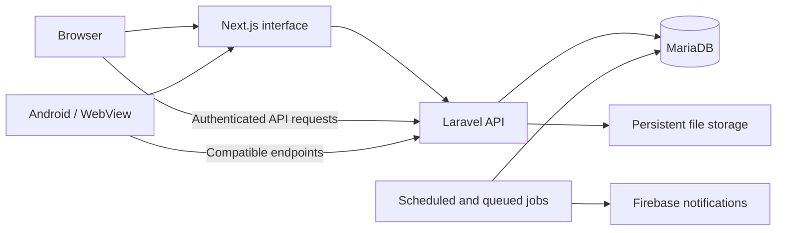

# Proposed architecture

## Application boundaries

This is one frontend and one modular backend. Separate microservices are unnecessary for the initial rebuild. Both applications can be maintained in one repository and deployed separately.

## Responsibilities

| Layer | Owns |
| --- | --- |
| Next.js | Public rendering, metadata, navigation, forms, dashboard presentation and interaction state |
| Laravel controllers/requests | Request parsing, validation, authentication entry points and response formatting |
| Laravel services | Orders, parcel transitions, custody, permissions-dependent workflows and financial operations |
| Policies and scoped queries | Ownership, roles, district restrictions and allowed resource visibility |
| MariaDB | Durable relational data, constraints, transactions and concurrency controls |
| Jobs/scheduler | Retryable notifications, expiry, reports and bounded reconciliation work |
| File storage | Public product/profile media and access-controlled private documents |

Next.js must not independently modify wallet balances or parcel ownership. UI visibility is a convenience; the backend enforces permissions for every operation.

## Authentication

- Keep Google OAuth account identity compatible with existing users; inspect current linkage before choosing a migration key.
- Prefer Laravel-owned first-party session authentication, with a supported integration such as Sanctum where appropriate.
- Plan frontend/API hostnames on the same registrable domain where practical. Confirm cookie domain, Secure, HttpOnly and SameSite behavior.
- Configure credentialed browser requests, allowed origins and CSRF protection explicitly.
- For authenticated Next.js server rendering, forward only the required session context to Laravel; never cache one user's private response for another user.
- Do not assume legacy PHP sessions work in Laravel. Plan re-login or an explicitly designed transition.
- Native Android API authentication, if needed, must be designed from actual Android requirements. A WebView using existing cookies may require a different approach.
- Preserve safe login-return behavior and validate redirects against the allowed site origin.

## Frontend structure

Use App Router pages as thin route boundaries. Put business-feature components, request functions, hooks, schemas and types in `src/features/`. Shared components belong in `src/components/`. Separate browser API calls from server API calls to avoid exposing server-only configuration.

Public products/profiles can use rendering and caching appropriate to visibility and freshness. Private dashboards, financial responses and participant location data require explicit private-cache behavior. Mutation results must refresh or invalidate affected views.

Keep initial polling where it meets existing behavior. Stop unnecessary polling on hidden pages and clean up timers. WebSockets are an optional later transport decision, dependent on hosting support and measured need.

## Backend structure

Use conventional Laravel controllers, form requests, resources, policies, models, services, jobs and commands. Group them by feature where useful. Avoid a universal controller or service recreating `index.php`.

Financial and custody services own transactions, locking and duplicate-request behavior. Controllers must not duplicate those rules. Notifications should dispatch after commit and failures should be observable and retryable.

## Data and time

Retain MariaDB initially; changing frontend/backend frameworks does not require changing database technology. Final table/model mappings follow database discovery.

Use exact decimal or integer-minor-unit money handling. Do not use binary floating-point arithmetic for new financial calculations. Preserve existing amounts through reconciliation.

Document the time convention before migration. Prefer UTC for new internal timestamps and Asia/Dhaka for display; inspect current DATETIME/TIMESTAMP meanings and session timezone before converting legacy data. Never blindly shift all stored timestamps.

## Hosting recommendation

Run Next.js on a host supporting its selected runtime features. Initially deploy Laravel and MariaDB on the current cPanel account after verifying prerequisites. Build outside cPanel to preserve its 1 GB memory allowance.

The Node.js selector shows available runtimes, not proof of production compatibility or sufficient capacity. A same-account Next.js deployment remains an experiment requiring startup, routing, restart and load verification.

## Operational requirements

Log request IDs, actor IDs and business operation IDs where useful, without tokens or private document contents. Track job failures and repeated financial/custody errors. Health endpoints should expose minimal status, not secrets or full infrastructure details.

Reference documentation: [Next.js backend capabilities](https://nextjs.org/docs/app/guides/backend-for-frontend), [Next.js self-hosting](https://nextjs.org/docs/app/guides/self-hosting), [Laravel deployment](https://laravel.com/framework/docs/deployment).
