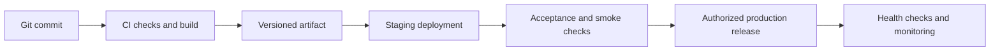

# Environments, hosting and CI/CD plan

No environments, workflows, credentials, applications or hosting settings have been created by this documentation task.

## Environments

| Environment | Purpose | Data/integrations |
| --- | --- | --- |
| Local | Development and automated checks | Isolated database, synthetic fixtures, test credentials |
| CI | Reproducible checks/builds | Ephemeral database/services; no production mutation credentials for ordinary checks |
| Staging | Full rehearsal and device testing | Separate database/files, staging OAuth and controlled FCM recipients |
| Production | Authorized live release | Existing business records, actual providers and restricted secrets |

Document exact commands and version requirements after scaffolding. Do not invent working setup commands before the applications exist. Include Node/package manager, PHP/Composer, database, environment setup, migrations, fixtures and test execution.

## Hosting arrangement

Proposed: Next.js on a suitable separate host; Laravel API plus MariaDB on current cPanel. Plan frontend/API hostnames together for session and OAuth behavior. Deploy Laravel outside the public document directory with only its `public/` directory exposed. Persist storage, environment settings and logs independently of release files.

For Laravel 13, official documentation requires PHP 8.3 or newer. The panel offers 8.3/8.4 but currently uses 8.2. Verify both web and CLI runtimes, required extensions and dependency compatibility before changing the runtime during an authorized deployment.

## cPanel prerequisites to verify

- PHP extensions, CLI binary, Composer availability and MariaDB connection limits.
- Correct API domain/document root, TLS and routing behavior.
- Writable application storage/cache directories and available release/backup disk space.
- External SSH or SFTP connectivity from the chosen CI runner, including host key verification.
- Runtime commands needed after release, with restricted credential access.
- Safe cron interval, job runtime and overlap behavior.
- Any provider limits on persistent daemons, outbound connections, symlinks and process lifetime.

The browser terminal is confirmed usable. External SSH connectivity, persistent workers, Redis, WebSockets and exact release restart commands remain unverified.

## CI workflow

For pull requests and relevant pushes:

1. Install locked dependencies using matching runtime versions.
2. Run frontend formatting/lint, type checks and meaningful component tests.
3. Run backend formatting/static checks and business/API tests against suitable database behavior.
4. Run Next.js production build and package backend dependencies/artifacts.
5. Run selected browser/integration checks against an isolated environment.
6. Publish identifiable artifacts and results for the exact commit.

Do not run untrusted pull-request code with production deployment secrets. Avoid deploying locally modified server files; releases should be traceable to a tested commit/artifact.

## CD workflow

Recommended pipeline:

Use an external service such as GitHub Actions for checks, builds and deployment orchestration. Branch/environment rules and available approval features depend on the selected repository/provider plan; verify them rather than assuming availability.

Backend deployment should upload a release artifact, attach persistent configuration/storage, apply reviewed compatible migrations, update caches and switch the served release using a verified mechanism. A symlink switch is preferred only if supported and rehearsed. Serialize deployments and retain the previous compatible release.

Frontend deployment uses the selected host's release mechanism. Coordinate API contract changes so either release order remains compatible; remove old contracts only after clients no longer need them.

## cPanel Git alternative

cPanel Git Version Control is enabled and its repository list was empty at inspection. A managed repository with a checked-in `.cpanel.yml`, a branch and a clean working tree can support deployment. Direct pushes can trigger cPanel's deployment hook; pulling from GitHub through the panel does not automatically create a complete CI pipeline.

If selected, keep build work in CI and use cPanel Git only for suitable deployment commands. Do not blindly copy the repository root into the public document directory.

## Jobs and scheduling

- Existing notification cron runs every minute by configuration; inspect its worker before replacement.
- Use Laravel's scheduler for expiry and other periodic work after verifying the PHP CLI/runtime.
- With no confirmed process supervisor, use bounded database-backed queue processing triggered by cron, with locks, runtime bounds and no overlap. Validate latency and provider policy first.
- For immediate/high-volume processing, move workers to a verified worker host or suitable managed service when required by measured needs.
- Expiry eligibility must also be checked when accepting a transfer, independent of scheduler timing.
- Dispatch notification work after commit, track failures, retry safely and prevent duplicate old/new worker activity.

## Storage and capacity

Keep private files outside public URLs, preserve persistent uploads between releases and plan orphan cleanup. Monitor database/file growth and retained release sizes within the approximately 5 GB allowance. Set capacity thresholds from measured staging usage; no user-count guarantee can be inferred from the 20-entry-process quota.

## References

- [cPanel Git deployment](https://docs.cpanel.net/knowledge-base/web-services/guide-to-git-deployment/)
- [GitHub deployment workflows](https://docs.github.com/en/actions/how-tos/deploy/configure-and-manage-deployments/control-deployments)
- [Next.js memory usage](https://nextjs.org/docs/app/guides/memory-usage)
- [Laravel deployment](https://laravel.com/framework/docs/deployment)
- [Laravel queues](https://laravel.com/framework/docs/13.x/queues)
- [Laravel scheduling](https://laravel.com/framework/docs/13.x/scheduling)

## Implemented CI and local runtime

The project includes `.github/workflows/ci.yml` for frontend types/lint/build and PHP syntax/formatting/dependency/schema-boot checks. Test cases are intentionally omitted. It runs when `PickparcelBD_new` is the repository root; it has not executed on GitHub yet. No deployment credentials, cPanel Git repository, cron entry or live runtime setting were created.

Build Next.js on CI or a development machine, outside the cPanel account’s 1 GB memory allowance. Set `BACKEND_URL` before the build. Use a separate Next.js host and cPanel PHP/MariaDB for the API after staging verification. cPanel Node selector availability alone is not a capacity guarantee.

Laravel’s scheduler has an every-minute bounded database worker, transfer expiry and presence expiry. Configure `DB_QUEUE_RETRY_AFTER=300`, exceeding the 120-second job timeout. The worker’s 45-second maximum is checked between jobs, so a running delivery may finish later. Review cron process overlap and actual host limits in staging.
