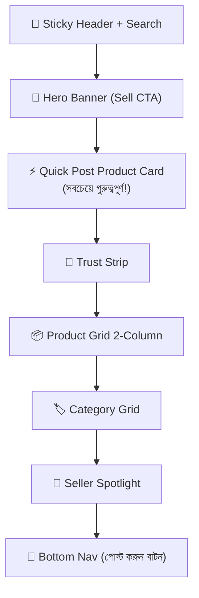

# 🎨 Magic Pattern Prompt — PickParcelBD হোম পেজ ডিজাইন

> **প্রজেক্ট:** PickParcelBD — Bangladeshi Marketplace & Parcel Delivery Platform
> **টেক স্ট্যাক:** Next.js 16, React 19, TypeScript, Tailwind CSS v4
> **প্রাইমারি ল্যাঙ্গুয়েজ:** বাংলা (Bangla)
> **কালার প্যালেট:** `--orange: #ed6333`, `--navy: #20352f`, `--green: #267658`, `--bg: #f7f8f4` (Tailwind classes: `bg-brand-orange`, `text-brand-navy`, `bg-brand-bg`, etc.)

---

## 📋 Magic Pattern Prompt (কপি করে পেস্ট করুন)

```
Design a professional, mobile-first home page for "পিকপার্সেল বিডি" (PickParcelBD) — a Bangladeshi online marketplace and parcel delivery platform. The interface should be entirely in Bangla (Bengali) language with a warm, trustworthy feel inspired by popular Bangladeshi apps like Pathao, Shajgoj, Chaldal, and Daraz Bangladesh.

---

## DESIGN SYSTEM

Colors:
- Primary: #ed6333 (warm orange — বাংলাদেশের পতাকার সূর্যের রঙ)
- Dark: #20352f (deep forest green-navy)
- Accent Green: #267658
- Background: #f7f8f4 (warm off-white)
- Text: #24342e
- Muted: #7c8780
- Border: #e8ebe5
- Card BG: white

Typography:
- Font: "Noto Sans Bengali" for Bangla text, "DM Sans" for numbers/English
- Heading sizes: 24px (mobile h1), 18px (h2), 15px (h3)
- Body: 14px, line-height 1.7

Radius: 14px cards, 10px buttons, 999px pills
Shadows: subtle — 0 4px 16px rgba(32,53,47,0.06)

---

## LAYOUT — MOBILE FIRST (375px default, show 390px iPhone preview)

### 1. 📱 STICKY TOP NAVIGATION BAR
- Height: 56px, white background, bottom border 1px #e8ebe5
- Left: Logo "🟠 পিকপার্সেল" in bold Bangla with orange dot accent
- Center: Search bar (rounded, placeholder: "পণ্য খুঁজুন...")
- Right: Cart icon (badge count) + Profile avatar circle
- Below nav: Horizontal scrollable category pill row (ফ্যাশন, ইলেকট্রনিক্স, খাবার, সৌন্দর্য, গৃহসজ্জা, অন্যান্য)

### 2. 🎯 HERO BANNER (Full width, 180px tall on mobile)
- Gradient background: linear-gradient(135deg, #ed6333 0%, #c8471d 100%)
- White bold Bangla headline: "আপনার পণ্য বিক্রি করুন, ঘরে বসেই!"
- Subtext: "বাংলাদেশের সেরা মার্কেটপ্লেসে বিক্রেতা হিসেবে যোগ দিন"
- TWO side-by-side CTA buttons (rounded, 44px height):
  ① White solid button: "🛍️ পণ্য দেখুন"
  ② White outline button: "📦 পণ্য পোস্ট করুন"
- Small floating badge top-right: "✅ ৫০,০০০+ বিক্রেতা"

### 3. ⚡ QUICK POST PRODUCT CARD (HIGH PRIORITY — most prominent after hero)
- Full-width card, white background, 14px padding, orange left border accent (4px)
- Bold label: "🚀 এখনই পণ্য যোগ করুন"
- Description: "মাত্র ৩টি ধাপে আপনার পণ্য লাখো ক্রেতার কাছে পৌঁছান"
- 3 Step indicators in a row (horizontal):
  ① 📷 ছবি তুলুন → ② 📝 তথ্য দিন → ③ ✅ পোস্ট করুন
- Large orange CTA button full-width: "পণ্য পোস্ট করুন →"
- Small text below: "বিনামূল্যে • কোনো কমিশন নেই • ৩০ সেকেন্ডে শেষ"

### 4. 🏪 TRUST STRIP (Horizontal scroll, 4 cards, 80px each)
Icons + small Bangla labels:
- 🚚 দ্রুত ডেলিভারি
- 🔒 নিরাপদ পেমেন্ট
- 📍 লোকেশন ট্র্যাকিং
- ❤️ বিশ্বস্ত সেলার

### 5. 📦 PRODUCT GRID — "সেরা পণ্যসমূহ" Section
- Section heading: eyebrow "আজকের সেরা" + h2 "জনপ্রিয় পণ্যসমূহ" + "সব দেখুন →" link right
- 2-column grid (mobile), card design:
  - Rounded image (aspect 1:1, object-fit cover, placeholder gradient)
  - Discount badge top-left (orange pill: "২০% ছাড়")
  - Product name (15px bold, 2 lines max, Bangla)
  - Seller name with small shop icon
  - Price: bold orange "৳ ৮৫০" with crossed-out original "৳ ১,০৫০"
  - Add to bag button: small orange circle with "+" icon (bottom right corner of card)
  - Heart/wishlist icon top-right corner
- Show 6 product cards (2x3 grid) with skeleton loading shimmer visible in one card

### 6. 🏷️ CATEGORY QUICK ACCESS (2x3 grid of icon cards)
Section title: "ক্যাটাগরি অনুযায়ী কিনুন"
6 category cards with emoji icons + Bangla label:
- 👗 পোশাক | 📱 ইলেকট্রনিক্স
- 🍎 খাদ্য | 💄 সৌন্দর্য
- 🪑 গৃহসজ্জা | 📦 অন্যান্য

### 7. 💼 SELLER SPOTLIGHT SECTION
- Light green background (#edf6ef), rounded card
- Heading: "বিক্রেতা হিসেবে যোগ দিন"
- 3 benefit items with green checkmarks:
  ✅ বিনামূল্যে দোকান খুলুন
  ✅ সারাদেশে ডেলিভারি সুবিধা
  ✅ নিরাপদ পেমেন্ট গ্যারান্টি
- Button: "আজই শুরু করুন →" (green, full-width)

### 8. 🔍 SEARCH & TRENDING (collapsible section)
- "ট্রেন্ডিং সার্চ:" label
- Horizontal scroll pill tags: শাড়ি, মোবাইল, জুতা, ব্যাগ, কসমেটিক্স, শার্ট

### 9. 📰 BOTTOM NAVIGATION BAR (Sticky, mobile)
5 tabs with icons + Bangla labels:
- 🏠 হোম (active, orange)
- 🔍 খুঁজুন
- ➕ পোস্ট করুন (center, large orange circle button elevated/floating)
- 🛒 কার্ট (badge)
- 👤 প্রোফাইল

### 10. FOOTER (Compact mobile footer)
- Logo + "বাংলাদেশ" flag emoji
- Links row: সম্পর্কে | শর্তাবলী | যোগাযোগ
- Copyright: "© ২০২৬ পিকপার্সেল বিডি"

---

## STYLE REQUIREMENTS

1. **Mobile-first**: Design primarily for 390px iPhone screen. Content stacks vertically.
2. **Bengali typography**: All labels, headings, and buttons in Bangla script. Numbers in Bengali (১, ২, ৩) or Arabic (1, 2, 3) mixed naturally.
3. **Card-based layout**: Everything in white rounded cards on the warm off-white (#f7f8f4) background — similar to Daraz Bangladesh / Shajgoj.
4. **Touch-friendly**: All tappable elements minimum 44x44px. Bottom nav always visible.
5. **Warm & trustworthy**: Orange accent used for CTAs and active states only. Green for success/verified states.
6. **Quick product posting is the #1 UX goal**: The "পণ্য পোস্ট করুন" action should be visible above the fold and in the bottom nav.
7. **No dark mode**: Light theme only with warm off-white background.
8. **Skeleton loaders**: Show 1-2 product card placeholders with shimmer effect to indicate loading state.
9. **Real Bangla content**: Use actual Bengali words (not Lorem Ipsum). Example product names: "হাতে বোনা শাড়ি", "অর্গানিক মধু ৫০০গ্রাম", "স্মার্টফোন কভার".
10. **Micro-interactions**: Subtle hover/tap states on cards (slight scale 1.02, shadow increase).

---

## REFERENCE SITES FOR INSPIRATION
- Daraz Bangladesh (daraz.com.bd) — product grid layout
- Shajgoj (shajgoj.com) — category cards, Bengali UI
- Pathao (pathao.com) — mobile-first, bottom nav
- Chaldal (chaldal.com) — quick ordering UX

Generate a complete, pixel-perfect mobile home page design with all sections above. Show the design in an iPhone 14 Pro frame (390x844px). The design should feel like a native Bangladeshi app that sellers trust to post products quickly and buyers trust to shop safely.
```

---

## 💡 বাড়তি টিপস Magic Pattern-এ

| টিপস | বিবরণ |
|------|--------|
| **ফ্রেম সিলেক্ট করুন** | iPhone 14 Pro (390×844) বা Samsung Galaxy S23 |
| **স্টাইল ট্যাগ** | "Bangladeshi marketplace", "Bengali UI", "mobile e-commerce" |
| **ভেরিয়েশন চাইলে** | প্রম্পটের শেষে "Generate 3 variations" যোগ করুন |
| **ডার্ক মোড বাদ** | "Light theme only, no dark mode" ইতিমধ্যে আছে |
| **কালার ফিক্স করতে** | প্রম্পটে exact hex codes দেওয়া আছে — Magic Pattern ব্যবহার করবে |

---

## 🎯 Key Design Priorities (গুরুত্বের ক্রম)



> [!IMPORTANT]
> **"পণ্য পোস্ট করুন" বাটন দুটি জায়গায় থাকবে:** Hero banner-এ এবং Bottom navigation-এর center-এ (floating action button হিসেবে)। এটিই এই হোম পেজের প্রধান UX লক্ষ্য।

> [!TIP]
> Magic Pattern থেকে ডিজাইন পাওয়ার পর, এই প্রম্পট ব্যবহার করে React/Next.js কোডে রূপান্তর করতে আবার আসুন — আমি সরাসরি আপনার `catalog.tsx` ফাইল আপডেট করে দেব।
